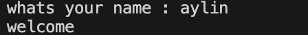
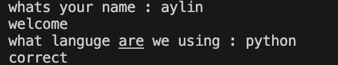
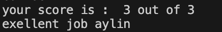

# pthon Quiz Game
A symple quiz game buld with python 

## Table of contents


  - [Features](#features)
  - [Project Structure](#project-structure)
  - [Requirment](#requirment)
  - [Installation](#installation)
  - [Envoirment Setup](#envoirment-setup)
  - [Usage](#usage)
  - [Example Output](#example-output)
  - [Screen Shut](#screen-shut)
  - [Roadmap](#roadmap)
  - [Cantrubuting](#cantrubuting)
  - [Licence](#licence)
  - [Author](#author)


## Features
- Quiz System
  - Asks the player multiple question
  - Cheks the answer automaticlly
  - Calvulatates the final score
- Rezult storage
  - Saves quiz result in `results.txt`
- Admin Mode
  - ask for the adminpasswor
  - check if the password is correct
  - keep the private information outside the main python file
  - Loads the password from `.env`

## Project Structure

```text 
python_quiz_pygame/
|   .env.example
|   .gitignore
|   requirements.txt
|   main.py
|   question.py
|   README.md
```
### File description
- `main.py` - main file used to run quiz game
- `question.py` - stores question and snwer
- `.env.example` -shows the envirment variables needed byt the project
- `requirements.txt`list the python package needed for the project 
- `gitignore` - talls git witch fils and folder shold
- not be tracked
- `README` - contains the project documenttion
## Requirment
Befor running the project , make sure you have :
- `python 3`
- `python-dotenv`

## Installation
1. open & terminal in the project total.
2. check that python in installed
```bash 
python --version
```
3. install the python pachages:
```bash
pip install -r requirments.tct
```

## Envoirment Setup
1. creat a `env` file from `.env.example`

```bash
cp .env.example .env
```
2. open the new `.env` file

3. replace the example value with your own password
   
```text 
QUIZ_ADMIN_PASSWORD=your_password_here
```
4. save the file.
   
> DO not commit your `env` file because it may contain private information

## Usage

1. open a terminal in the project folder
2. run the quiz game
```bash
python main.py
```
3. choose `yes` or `no` for admin mode
4. if if you choose `yes`, enter the password from your `.env` file
5. enter your name
6. answer the question
7. see your final score and massage
8. your result is saved in `result.txt`
## Example Output
```text
do u want to open admin made ? yes/no : yes

enter admin password : 1234

whats your name : aylin
welcome

what languge are we using : python
correct

what command start a git : git init
correct

what command show git status : git status
correct

your score is :  3 out of 3
exellent job aylin

```
## Screen Shut

### start game


### QUIZ 


### final score


## Roadmap
- [x] add multiple quiz question
- [x] calculate the final score
- [x] save results to a file
- [x] add admin mode
- [ ] add more quiz questions
- [ ] add difficultly levels 
- [ ] add a timer

## Cantrubuting

## Licence

## Author
create by [Aylin sadeghi ]()
